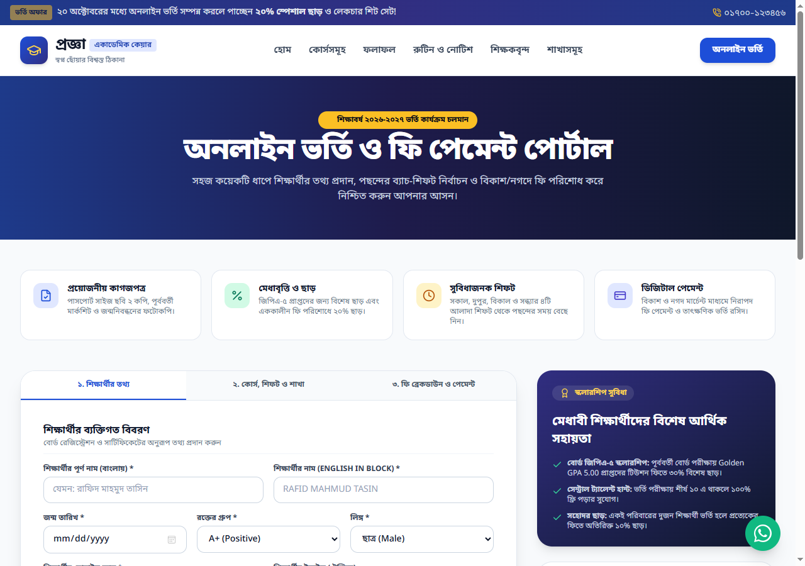
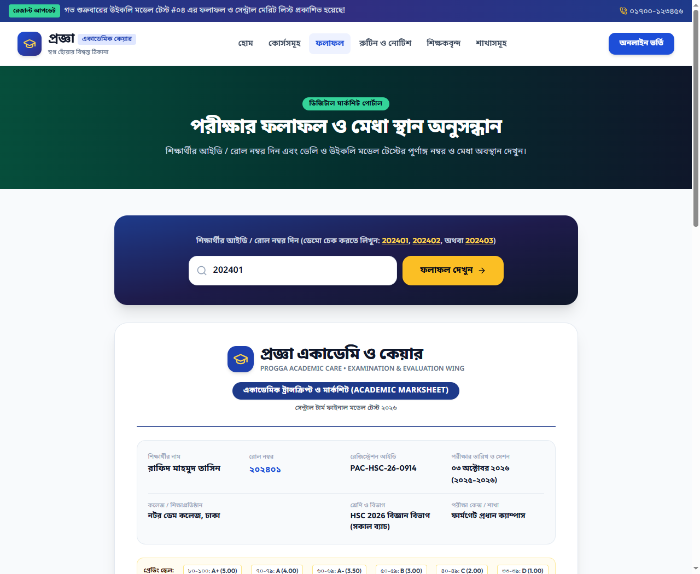
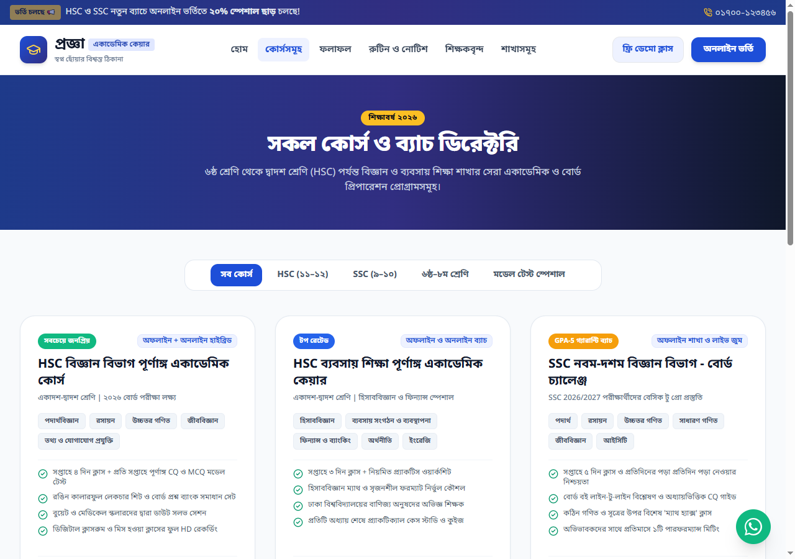

# 🎓 Progga Academic Care (প্রজ্ঞা একাডেমি ও কেয়ার)
### Production-Grade Web Platform for Secondary & Higher Secondary Academic Coaching in Bangladesh

[](http://localhost:3000/)
[](https://fonts.google.com/noto/specimen/Noto+Sans+Bengali)
[](#license)

---

## 📌 Executive Summary

**Progga Academic Care** is an enterprise-grade, multi-page web application engineered specifically for the Bangladeshi academic ecosystem covering **Class 6–10 (SSC)** and **Class 11–12 (HSC)**. 

Designed to replace fragmented offline processes with seamless digital workflows, the platform provides an official **Academic Transcript & Marksheet Portal**, an end-to-end **Multi-Step Online Admission Wizard** with automated fee calculation and mobile financial services (bKash/Nagad) reconciliation, comprehensive **Course Directories**, and interactive **Branch Locators**.

Built with modern web standards, zero third-party framework dependencies, and tailored for Bangladeshi educational benchmarks, the platform delivers instant load times, robust cross-browser accessibility, and clean print-ready document engines.

---

## 🖥️ Platform Showcase

### 1. Landing Page & Fast Admissions Desk
> Features an urgency-driven hero section, live countdown timer for upcoming batches, fast seat-booking widget, key institutional metrics, and verified social channels.


---

### 2. Multi-Step Online Admission & Billing Wizard
> Streamlines student onboarding through a 3-step guided wizard: personal biodata, branch & shift allocation, automatic early-bird discount computation, bKash/Nagad TrxID verification, and instant printable admission receipts.



---

### 3. Digital Academic Marksheet & Evaluation Portal
> Generates official Bangladeshi academic transcripts by roll number, complete with subject codes, CQ/MCQ/Practical mark breakdowns, letter grades, central merit rankings, and dedicated A4 portrait PDF print styling.



---

### 4. Comprehensive Course & Curriculum Catalog
> Interactive catalog categorizing HSC Science & Business Studies, SSC Board Challenge batches, Junior foundations, and Model Test programs with detailed fee structures and feature matrices.



---

## 🚀 Key Functional Modules

### 📊 Official Bangladeshi Academic Marksheet Engine
- **Roll Number Lookup**: Instant student record retrieval supporting daily/weekly model tests and term finals.
- **National Curriculum Compliant**: Full breakdown of marks across Creative Questions (CQ/50), Multiple Choice (MCQ/25), Practical/CT (25), Total (100), Letter Grades, and Grade Point Averages (GPA).
- **Comparative Metrics**: Displays Central Merit Rank, batch highest scores, attendance percentages, and controller verification seals.
- **Dedicated A4 Print Layout**: Pre-configured CSS `@media print` rules hide browser navigation, search bars, and footers, rendering a crisp, pixel-perfect A4 transcript ready for physical printing or PDF export.

### 📝 End-to-End Admission & Tuition Management
- **3-Step Intelligent Wizard**:
  - **Step 1 - Biodata**: Student bilingual names (Bangla & English block), contact numbers, blood group, gender, institution, and guardian details.
  - **Step 2 - Program Selection**: Choice of 4 physical campuses (Farmgate, Mirpur, Uttara, Dhanmondi) or Live Online batches, class shifts (Morning, Day, Afternoon, Evening), and elective subjects.
  - **Step 3 - Financial Settlement**: Real-time invoice generation with automatic 20% early-bird discounts and sibling waivers.
- **Mobile Financial Services Integration**: Step-by-step transaction walkthrough for **bKash**, **Nagad**, and **Rocket** merchant transfers with TrxID submission.
- **Digital Admission Receipt**: Generates a tamper-evident confirmation slip with invoice ID, QR/barcode placeholder, and official countersignature.

### 🌐 Cross-Browser Typography & High-Contrast Forms
- **Typography Standards**: Fully rendered with Google Font **[Noto Sans Bengali](https://fonts.google.com/noto/specimen/Noto+Sans+Bengali)** for Bengali literature and **[Outfit](https://fonts.google.com/specimen/Outfit)** for Latin alphanumeric data.
- **High-Contrast Input Protection**: Hardened CSS rules (`color-scheme: light`, `-webkit-text-fill-color`, explicit background and caret overrides) ensure that inputs never render invisible or washed-out text, even on systems with Dark Mode extensions or Windows high-contrast themes.

### 📍 Campus Directory & Mentorship Network
- **Branch Infrastructure**: Physical addresses, direct hotline numbers, Google Maps integrations, and appointment booking across central Dhaka hubs.
- **Faculty Profiles**: Credentialed mentor showcase featuring alumni from BUET, Dhaka University, and Dhaka Medical College (DMC).

---

## ⚡ Quick Start & Execution

### Prerequisites
- [Node.js](https://nodejs.org/) (Version 16.0 or higher)

### Starting the Local Server

1. **Clone or Navigate to the Project Root:**
   ```bash
   cd "f:/prokect/project -7"
   ```

2. **Launch the Server:**
   ```bash
   node server.js
   ```

3. **Access the Portal via Web Browser:**
   - **Main Homepage:** [http://localhost:3000/index.html](http://localhost:3000/index.html)
   - **Admission Portal:** [http://localhost:3000/admission.html](http://localhost:3000/admission.html)
   - **Marksheet & Results:** [http://localhost:3000/results.html](http://localhost:3000/results.html)
   - **Course Directory:** [http://localhost:3000/courses.html](http://localhost:3000/courses.html)
   - **Routines & Notices:** [http://localhost:3000/routines.html](http://localhost:3000/routines.html)
   - **Faculty Showcase:** [http://localhost:3000/teachers.html](http://localhost:3000/teachers.html)
   - **Campus Locations:** [http://localhost:3000/branches.html](http://localhost:3000/branches.html)

---

## 🧪 Demo Verification Data

The evaluation portal comes pre-populated with realistic academic datasets for immediate testing:

| Roll Number | Student Name | Educational Institution | Academic Program | Result & Merit |
| :---: | :--- | :--- | :--- | :---: |
| **`202401`** | Rafid Mahmud Tasin | Notre Dame College, Dhaka | HSC Science (Batch 2026) | **GPA 5.00** (Central Rank: 1st) |
| **`202402`** | Afsana Mimi | Viqarunnisa Noon School & College | HSC Science (Batch 2026) | **GPA 5.00** (Central Rank: 2nd) |
| **`202403`** | Tanvir Hasan Nibir | Dhaka Residential Model College | HSC Science (Batch 2026) | **GPA 4.90** (Central Rank: 3rd) |
| **`202404`** | Mariam Binte Rafiq | Holy Cross College, Dhaka | HSC Business Studies | **GPA 5.00** (Central Rank: 1st) |
| **`202405`** | Sabbir Ahmed | Government Laboratory High School | SSC Science (Batch 2026) | **GPA 5.00** (Central Rank: 1st) |

---

## 🛠️ Technology Stack

| Layer | Technologies & Tools |
| :--- | :--- |
| **Markup & Layout** | Semantic HTML5, Multi-Page Web Architecture |
| **Styling & Design System** | Tailwind CSS (JIT via CDN), Custom CSS Grid / Flexbox, Print CSS |
| **Typography** | Noto Sans Bengali (Google Fonts), Outfit (Google Fonts) |
| **Iconography** | Lucide Icons, Brand SVG Vectors (Facebook, YouTube, WhatsApp) |
| **Client Controller** | Modern ECMAScript (ES6+), Event-driven State Handling |
| **Backend / Server** | Node.js Built-in HTTP Server (Zero External Dependencies) |
| **Export Engines** | Browser Native Print Engine (`@media print`, `@page { size: A4 portrait }`) |

---

## 📄 License

This project is licensed under the **MIT License**. Feel free to use, customize, and extend for institutional and commercial education implementations.

&copy; 2026 **Progga Academic Care**. All Rights Reserved.
